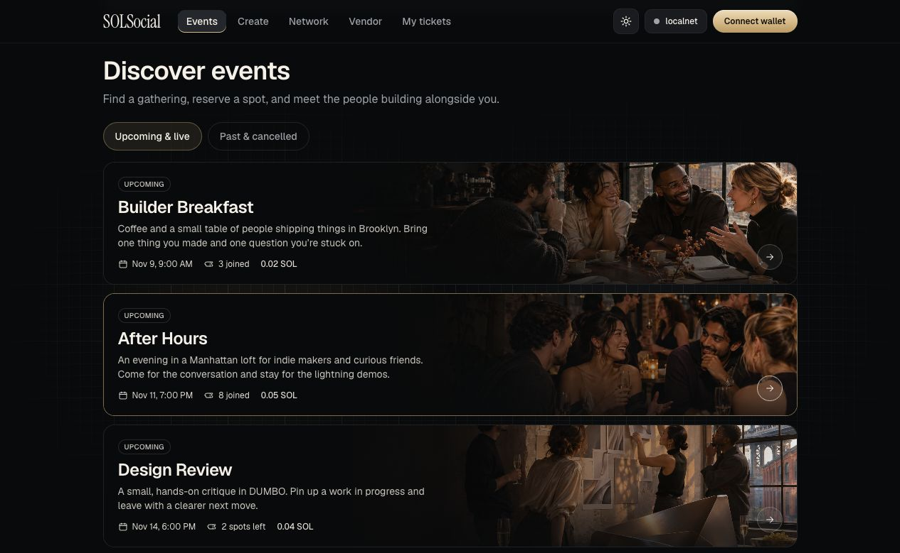

# SOLSocial

**Host events people show up for.**

SOLSocial is an event-hosting app that turns each RSVP into a small SOL payment. Ticket sales build an event pool, and guests who check in can claim a share after the event.

Imagine hosting a large community event with your guest list, ticketing, and catering payments handled in one place. You can see who has reserved, check guests in with a QR scan, and pay an approved caterer from the same pool after delivery is verified and the event closes.

[Open the live demo](https://solana-hackathon-2026.vercel.app/) · [Read the project overview](docs/PROJECT.md)

_Event discovery in the seeded local demo._

## From RSVP to payout

1. **Host an event.** Set the ticket price and the percentage of the pool to share with attendees.
2. **Build the guest list.** Each paid RSVP reserves a spot and adds SOL to the event pool.
3. **Check guests in.** Scan a signed QR pass at the door. The pass refreshes every 20 seconds, and the check-in is recorded on Solana.
4. **Settle after the event.** Guests who checked in can claim equal shares of the attendee allocation. Approved vendors can collect payment from the host’s budget after delivery is verified.
5. **Find the next event.** Guests can discover events hosted by people they’ve attended events with before.

## What Solana handles

An Anchor program holds ticket payments in escrow and locks in the payout split at event creation. It records check-ins and enforces attendee and vendor payouts. The app uses shared attendance to surface network-only events in a guest’s feed.

## Try it

Browse the live demo without a wallet. To create an event or reserve a ticket, connect Phantom on **Solana Devnet** and use test SOL. To run the app locally, see the [developer guide](docs/DEVELOPMENT.md).

Built by Kobe Zheng for the [MLH Solana Hackathon](https://www.mlh.com/events/solana-hackathon).
