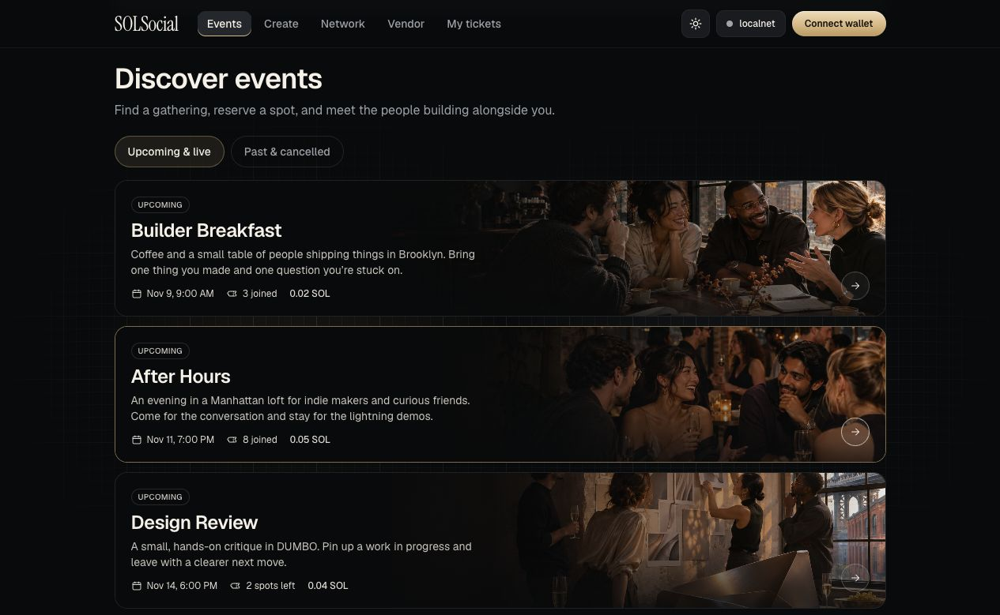

# SOLSocial

**Sell tickets, check guests in, and share the event pool on Solana.**

A free RSVP gives hosts a rough headcount, but they still have to budget before they know who will come. SOLSocial lets guests reserve a spot with SOL. Ticket fees build an event pool as people book, and guests who check in can claim a share after the event.

[Open the live demo](https://solana-hackathon-2026.vercel.app/) · [View the source code](../)

*Event discovery with sample events.*

## How it works

1. **Host an event.** Set a ticket price and choose what percentage of the pool goes to attendees. The Solana program locks that percentage when the event is created.
2. **Reserve a spot.** Guests pay the ticket price in SOL. Each payment goes into an escrow account controlled by the event program.
3. **Check in at the door.** Guests show a signed QR pass that refreshes every 20 seconds. The host scans it to verify the pass and record attendance on Solana.
4. **Claim a share.** When the host closes the event, guests who checked in can each claim an equal share of the amount set aside for attendees.

Hosts can also approve vendor proposals and pay vendors from the pool when a delivery QR code is scanned. Past attendance helps guests discover events through people they’ve already attended events with.

## What Solana handles

The Anchor program holds ticket payments, enforces the payout split, and records check-ins. A guest can see the payout percentage before buying a ticket and claim their share directly after the event closes. Solana’s low transaction fees make it practical to record each check-in and pay out small amounts individually.

## Try the demo

Use a Phantom wallet on Solana Devnet with test SOL to create an event or reserve a ticket. The screenshot above shows sample events from the [local demo](SEED.md).
